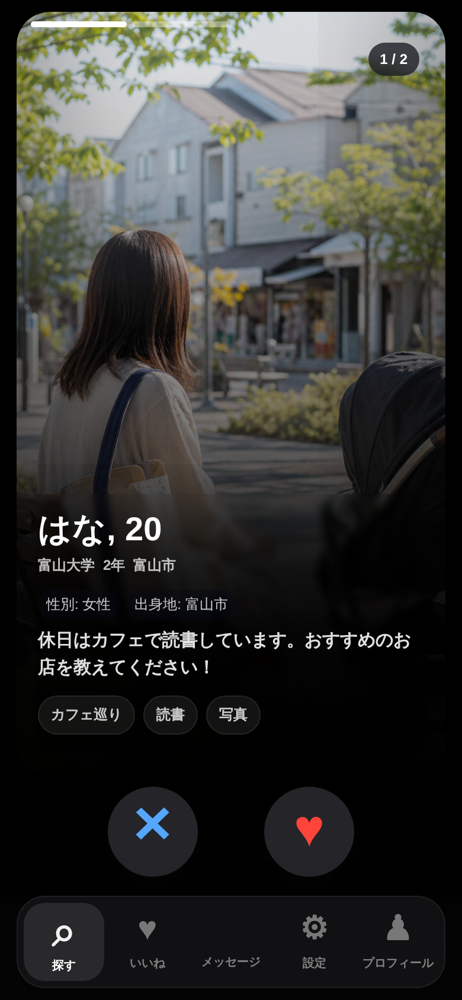
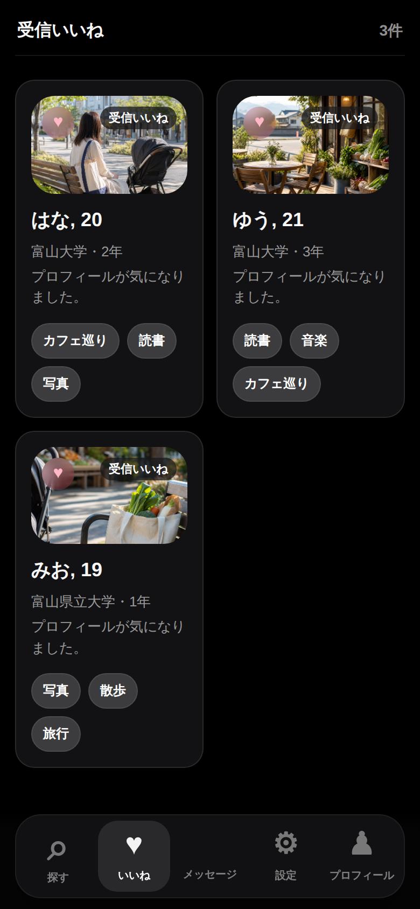
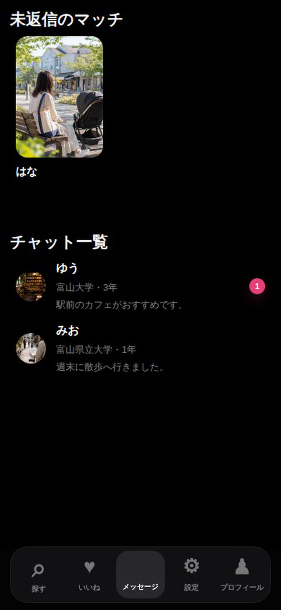
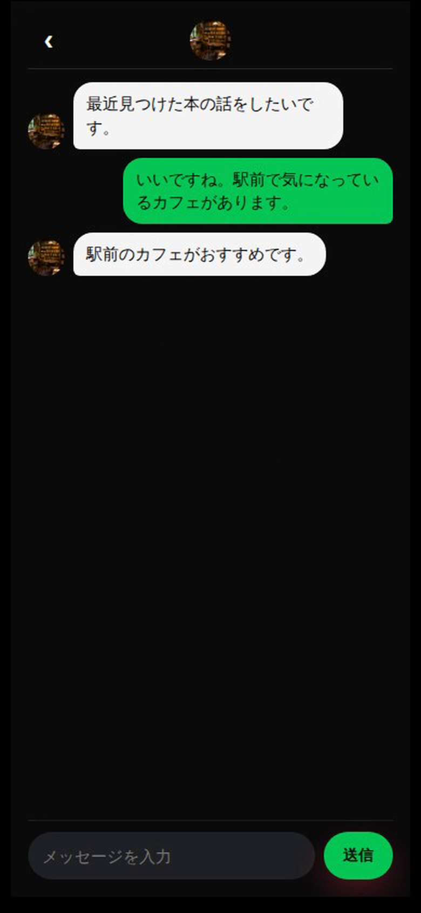
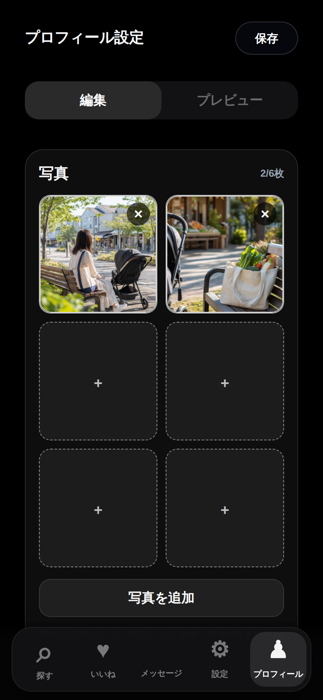
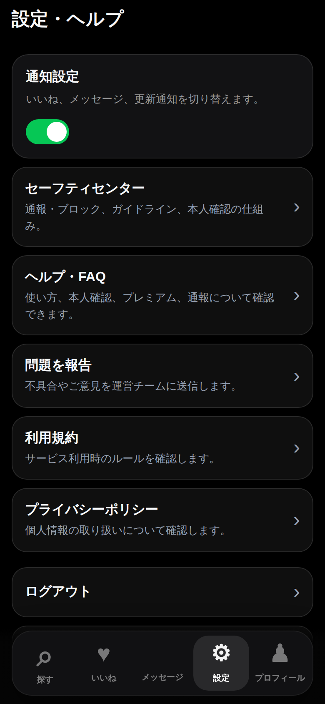
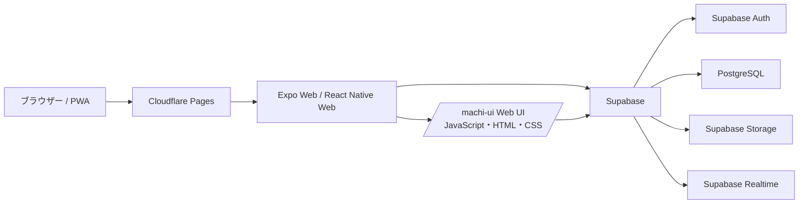

# とみあい（Campus Match）

## 概要

とみあいは、富山県内の大学生が地域の同世代と知り合い、共通の趣味や価値観をきっかけに交流を始められる場を目指して開発したマッチングアプリです。プロフィールから相手を探し、相互に「いいね」するとマッチが成立してチャットを始められます。相手探しから会話までを一つのアプリで行え、通報・ブロック機能も備えています。スマートフォンのブラウザーからも利用できるWebアプリ／PWAとして開発しています。

## 操作デモ

**[操作デモを開く](https://yamadatarou11.github.io/toyamatching/)**

探す・いいね・マッチ・チャットなどを実際の画面で操作できます。デモの操作内容はブラウザー内だけに保存され、Supabaseや実アカウントには接続しません。画面上部の「デモを初期状態に戻す」ボタンで、操作データを消して最初の状態からやり直せます。

## 操作動画


## 画面例

主要画面を6枚掲載しています。

| 01 相手探し | 02 受信いいね | 03 マッチ・会話一覧 |
| --- | --- | --- |
|  |  |  |

| 04 チャット | 05 プロフィール管理 | 06 安全・設定 |
| --- | --- | --- |
|  |  |  |

## 主な機能

- プロフィールの登録・編集、写真と趣味・性格タグの設定
- プロフィールカードのスワイプやボタンによる「いいね」「見送り」
- いいねの送受信、相互いいねによるマッチング
- マッチ後のメッセージ一覧とチャット
- 通報・ブロックなどの安全機能
- PWA対応。スマートフォンのホーム画面に追加して利用可能

## 技術構成・選定理由

初期利用者数を約100人と想定し、MVP段階の費用と運用負担を抑える方針で技術を選びました。Cloudflare PagesでWeb版を配信し、Supabase Freeと組み合わせて初期費用を抑えることを目指しています。SupabaseはPostgreSQLに加えて認証・写真保存・リアルタイム更新をまとめて利用でき、個別のバックエンドサーバーを構築・運用する作業を減らせます。

| 技術 | 用途 | 選定理由 |
| --- | --- | --- |
| React Native・Expo | iOS・Android向けアプリ | Reactの経験を活かし、両OS向けの開発を共通化してMVPを早く形にするため |
| Expo Router | アプリの画面遷移 | Expoとの相性がよく、画面ファイルに沿ってルートを管理できるため |
| Zustand | アプリ内の状態管理 | 認証状態やプロフィールを、MVPに合ったシンプルな構成で管理するため |
| React Native Web | Web版 | Expo / React Nativeのアプリ基盤をWebでも利用するため |
| TypeScript | アプリ画面・データモデル | プロフィールやマッチなど、画面間で共有するデータ構造を明示するため |
| JavaScript・HTML・CSS | Web版の相手探し・チャットUI | 既存のWeb画面の操作や表示を柔軟に調整するため |
| Supabase Auth・PostgreSQL・Storage・Realtime | 認証・データ・写真・チャット | ユーザー・いいね・マッチの関係を扱い、認証・画像保存・リアルタイム更新をまとめて利用できるため |
| Cloudflare Pages | Web版の配信 | 初期利用者約100人を想定した段階で、Supabase Freeと合わせて無料枠を活用し、運用費とサーバー管理の負担を抑えるため |
| PWA（Web Manifest・Service Worker） | ホーム画面への追加とアプリシェルのキャッシュ | スマートフォンのブラウザーからアプリとして利用できるようにするため |

Web版はCloudflare Pages上のExpo Webから、相手探し・チャットなどのWeb UIを表示します。認証とアプリデータはSupabaseに接続します。

## アプリ構成



## ローカルで起動する

Node.jsとnpmを用意し、リポジトリのルートで以下を実行します。

```sh
cd app
npm install
cp .env.example .env
```

`.env` にSupabaseプロジェクトのURLとAnon Keyを設定してから、Web版を起動します。

```sh
npm run web
```

Web用の静的ファイルを生成する場合:

```sh
npm run build:web
```

出力先は `app/dist/` です。`.env` には認証情報を設定するため、Gitにコミットしないでください。設定項目の例は [app/.env.example](app/.env.example) を参照してください。

## Cloudflare Pagesへのデプロイ

- Root directory: `app`
- Build command: `npm run build:web`
- Build output directory: `dist`
- 環境変数: `EXPO_PUBLIC_SUPABASE_URL`、`EXPO_PUBLIC_SUPABASE_ANON_KEY`

Supabase Auth側にも公開URLをSite URLとRedirect URLsとして登録してください。詳細は[デプロイ手順](app/docs/cloudflare-pwa-deploy.md)を参照してください。

## リポジトリ構成

```text
app/app/                    Expo Routerによるアプリ画面
app/lib/                    Supabaseクライアントなどの共通処理
app/store/                  Zustandによる状態管理
app/public/machi-ui/        Web版の相手探し・チャットUI
supabase/migrations/        DBスキーマ、トリガー、RLSのマイグレーション
readme-assets/              操作動画と6画面のスクリーンショット
```
